# Studio Crit



Eleven creative specialists review your website and deliver one prioritized improvement plan.

Studio Crit is a Codex skill for teams deciding what to change before a launch or redesign. Give it a site and a task your visitor cares about. The team follows that journey, identifies where the design helps or gets in the way, and hands back decisions a designer or engineer can act on.

[Run your first crit](#quick-start) · [Try the included example](#try-the-included-example) · [See a sample finding](#a-finding-from-a-sample-review) · [Read the full review brief](.agents/skills/studio-crit/SKILL.md)

## Quick start

Use a Codex environment that can spawn subagents. For a live review, it also needs browser access to the site. Clone the repository and open the resulting folder in Codex.

```sh
git clone https://github.com/Lexicoding-Labs/studio-crit.git
cd studio-crit
```

Paste this into Codex, replacing the bracketed text with your URL and visitor task.

```text
Use $studio-crit to review [website URL].
Follow a first-time visitor trying to [book a session, choose a plan, or request a quote].
Review desktop and mobile. Tell me what to preserve, what to fix first,
who should own each change, and how we'll know it worked.
```

**Use it inside an existing project.** Copy the entire [studio-crit skill directory](.agents/skills/studio-crit/) into that project's `.agents/skills/` folder, then run the same prompt from the project. A review is read-only by default. Ask separately when you want changes implemented.

## Try the included example

Start with [Folio Bindery](examples/folio-bindery.html), the single-page sample used in the review below. After cloning, open the HTML file in a browser to see the page, or give Codex this prompt from the repository root. The sample runs locally and uses a placeholder email address.

```text
Use $studio-crit to review examples/folio-bindery.html.
I own a book with a damaged spine and want to keep its original covers.
Can I tell which repair to choose and what to send the workshop?
Check the service comparison at 375 px and at desktop width if a browser
is available. Identify anything that still needs a live test.
```

For a quick manual check, narrow the browser window and try to compare both repair descriptions without hovering. Then try again with a pointer. The example preserves the original behavior so you can reproduce the finding yourself.

## A finding from a sample review

In a bookbindery sample, the most useful copy on the page explained which repair would keep a customer's original covers. The stylesheet made that sentence invisible until someone hovered over the service. Four disciplines had reason to flag it. The team turned their observations into one decision.

| Handoff | Example |
| --- | --- |
| Priority and location | **Now** · “At the bench” service comparison |
| Visitor decision | Can I have the spine repaired and keep these covers? |
| Evidence | Both service descriptions start at zero opacity. Only hovering over an article reveals its text. |
| Change | Show the cover outcome directly beneath each service name from first paint. Preserve the wording that distinguishes keeping the covers from replacing them. |
| Owner and effort | Design Engineer, with Editorial Designer review. Small CSS change using existing copy. |
| Acceptance check | On a 375 px touch viewport and with keyboard-only navigation, verify that both outcomes are readable before choosing a service. |

The source also showed that the two cards and their gap needed at least 640 px before page padding. Making the descriptions visible would still leave the second card offscreen on a narrow phone. The producer kept a separate layout check. This sample was reviewed from HTML and CSS. The browser checks above are the proposed retest.

## What comes back

1. **The first decision.** The most consequential change, the visitor task it supports, and the part of the design worth preserving.
2. **A coverage record.** Pages, templates, viewports and journey states inspected, with samples and gaps identified.
3. **A ranked backlog.** Now, Next and Later items tied to evidence, an accountable owner, dependencies, relative effort and an observable acceptance check.
4. **A delivery sequence.** What the team can start immediately, which decisions need the site owner, and how competing recommendations were resolved.

## Who reviews the site

| Question | Assigned agents |
| --- | --- |
| Can visitors tell who the offer is for, how the options differ, and what to do next? | Brand Strategist · Creative Copywriter |
| Do the imagery, typography and reading order give the right details prominence? | Art Director · Brand Designer · Editorial Designer |
| Can someone complete the task across devices and input methods? Does movement clarify what just happened? | Product Designer · Motion Designer · Design Engineer |
| Does the experience after an inquiry, booking or purchase match the promise on the site? | Experiential Designer |
| Which creative direction wins when specialists disagree? | Creative Director |
| Who owns each fix, what comes first, and what counts as done? | Creative Producer |

The nine specialists inspect the evidence first. The Creative Director forms an independent impression before reading their findings. The Creative Producer then sequences the agreed work. Agents run in waves when slots are limited. The report identifies any roles or surfaces the team could not cover.

## Choose your review material

| Supply | What the team can establish |
| --- | --- |
| Live URL or running local build | Inspect rendered layouts, interaction states, keyboard flow and responsive behavior where accessible. Use a preview or test fixture for states beyond a real booking or purchase. |
| Source files | Trace layout rules, copy, routes and implemented behavior. Flag predictions that need a browser retest. |
| Screenshots or design exports | Review the visible composition, hierarchy, identity and wording. Record interaction and completion states as unverified unless the supplied material shows them. |

## Common questions

**Do I need eleven agent slots?** The coordinator can run specialists in waves. The full review needs a Codex environment that can spawn agents. Any missing roles appear in the report.

**Can I keep my site's current identity?** Yes. Name the elements you want to keep in the brief, such as the typeface, photography or voice. Ask the Creative Director which changes improve the visitor journey within those constraints.

**What should I do with the report?** Start with a Now item and give its owner the evidence and acceptance check. After the change, rerun that same journey at the original viewport and input method. That gives the team a concrete way to close the item.
